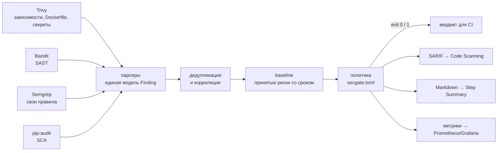

# secgate — единый гейт безопасности для CI

[](https://github.com/tob1s3/secgate/actions/workflows/ci.yml)

Когда в пайплайне работают несколько сканеров (Trivy, Bandit, Semgrep, pip-audit), у каждого свой формат,
своя шкала критичности и свои дубли. Одна и та же CVE приходит дважды: от Trivy и от pip-audit. Bandit и Semgrep
подсвечивают одну и ту же строку. В итоге либо сборка падает на всём подряд и гейт отключают, либо отчёты
никто не читает.

**secgate** собирает отчёты всех сканеров, приводит их к одной модели, убирает дубли, применяет политику
и baseline принятых рисков. На выходе — одно решение «пропустить / остановить сборку», SARIF для
GitHub Code Scanning, сводка в Pull Request и метрики для Prometheus.



## Что умеет

- **Распознаёт формат по содержимому**, а не по имени файла: Trivy (SchemaVersion 2), Bandit, Semgrep, pip-audit.
- **Единая шкала критичности:** `ERROR`, `MODERATE`, `NEGLIGIBLE` и прочие варианты разных сканеров
  сводятся к `LOW / MEDIUM / HIGH / CRITICAL`. У Bandit при низкой уверенности (confidence) критичность снижается на шаг.
- **Дедупликация зависимостей:** отпечаток строится по пакету, версии и CVE, а не по сканеру. Имя пакета
  нормализуется по PEP 503 (`PyYAML` = `pyyaml`). Дубль получает максимальную оценку и список всех сканеров-источников.
- **Корреляция кода:** если Bandit и Semgrep указали на одну строку одного файла с одним и тем же CWE —
  это одна находка.
- **Стабильные отпечатки:** номер строки в отпечаток кода не входит, поэтому правка выше по файлу не «создаёт»
  новую находку и не ломает baseline.
- **Baseline с обязательным сроком.** Каждое исключение должно содержать причину и дату истечения не дальше
  180 дней. После этой даты находка снова блокирует сборку. Исключения, которые больше ничему не соответствуют,
  secgate предлагает удалить.
- **Секреты нельзя «принять»:** утёкший ключ отзывают и вычищают из истории, а не заносят в исключения.
- **Отчёты:** SARIF 2.1.0 (проверяется по официальной схеме OASIS в тестах), Markdown для `GITHUB_STEP_SUMMARY`,
  метрики Prometheus в формате textfile.
- **Понятные коды выхода:** `0` — пропустить, `1` — гейт сработал, `2` — ошибка входных данных
  (битый отчёт, неверная политика или baseline). Ошибка конфигурации не маскируется под «всё хорошо».
- Нет внешних зависимостей во время работы — только стандартная библиотека Python 3.11+.

## Быстрый старт

```bash
pip install git+https://github.com/tob1s3/secgate
# или: docker build -t secgate . && docker run --rm -v "$PWD:/reports:ro" secgate check ...

bandit -r src -f json -o bandit.json
semgrep scan --config .semgrep/python-security.yml --json -o semgrep.json src
pip-audit -r requirements.txt -f json -o pip-audit.json
trivy fs --scanners vuln,misconfig,secret --format json -o trivy.json .

secgate check bandit.json semgrep.json pip-audit.json trivy.json \
  --policy secgate.toml --baseline .secgate-baseline.json \
  --sarif secgate.sarif --metrics secgate.prom
```

Результат на учебном уязвимом приложении из [`examples/vulnerable-app`](examples/vulnerable-app):

```text
secgate: bandit.json — bandit, находок: 6
secgate: pip-audit.json — pip-audit, находок: 24
secgate: semgrep.json — semgrep, находок: 4
secgate: trivy.json — trivy, находок: 11
secgate: 24 уникальных находок, новых 24 — ЗАБЛОКИРОВАНО: найдено секретов в репозитории: 1; находок уровня HIGH и выше: 7
```

45 сырых находок превратились в 24: 7 CVE пришли одновременно от Trivy и pip-audit, у pip-audit были
повторы, а две проблемы в коде нашли и Bandit, и Semgrep. Фрагмент сводки, которая попадает в Pull Request:

| | Тип | Где | Что | Исправление | Источник |
|---|---|---|---|---|---|
| 🟥 | dependency | `pyyaml 5.3` | CVE-2020-1747: PyYAML: arbitrary command execution through python/object/new… | 5.3.1 | pip-audit, trivy |
| 🟥 | secret | `settings.py:3` | aws-access-key-id: AWS Access Key ID | — | trivy |
| 🟧 | code | `app.py:12` | B602: subprocess call with shell=True identified, security issue. | — | bandit, semgrep |
| 🟧 | config | `Dockerfile` | AVD-DS-0002: Image user should not be 'root' | — | trivy |

## Политика

```toml
# secgate.toml
[policy]
fail_on = "HIGH"        # блокировать при новой находке этого уровня и выше
unknown_as = "MEDIUM"   # как считать находки без оценки (pip-audit её не даёт)
block_secrets = true    # секрет блокирует всегда

[policy.max_count]
MEDIUM = 10             # и не больше 10 новых MEDIUM
```

Опечатка в уровне (`fail_on = "HIHG"`) — это ошибка с кодом выхода `2`, а не тихое отключение гейта.

## Baseline принятых рисков

```bash
secgate fingerprints *.json      # отпечаток, уровень, тип, CVE/правило, где
```

```json
{
  "exceptions": [
    {
      "fingerprint": "c89424cb06fa67b8",
      "reason": "Уязвимый вызов не используется; обновление в задаче INFRA-142",
      "expires": "2027-03-01",
      "owner": "team-backend"
    }
  ]
}
```

Если срок истёк, находка снова блокирует сборку, а в сводке появляется раздел «Истёк срок исключений»
с владельцем и причиной.

## Метрики

```text
secgate_findings{project="shop",severity="critical",kind="dependency",status="new"} 2
secgate_findings{project="shop",severity="high",kind="code",status="accepted"} 1
secgate_fixable_findings{project="shop"} 12
secgate_gate_blocked{project="shop"} 1
```

Файл подходит для textfile collector у node_exporter или для отправки в Pushgateway. В Grafana по нему
строится тренд: сколько уязвимостей открыто в каждом проекте, сколько из них можно закрыть простым обновлением
и сколько «висит» в исключениях.

## CI этого репозитория

[`.github/workflows/ci.yml`](.github/workflows/ci.yml):

| Job | Что делает |
|---|---|
| `test` | ruff, ruff format, pytest с покрытием не ниже 90 % на Python 3.11–3.13; actionlint и hadolint |
| `security` | secgate проверяет сам себя: Bandit, Semgrep, pip-audit, Trivy → secgate → SARIF в Code Scanning |
| `demo` | прогон по `examples/vulnerable-app`: job **падает, если гейт не остановил** сборку |
| `docker` | сборка образа, проверка, что контейнер запускается не от root, smoke-тест |

Принципы, по которым собран пайплайн:

- права `GITHUB_TOKEN` по умолчанию только на чтение; `security-events: write` выдаётся одному job;
- все сторонние actions закреплены по SHA коммита, обновления приносит Dependabot;
- `persist-credentials: false` — токен не остаётся в `.git/config`;
- сканеры ставятся через pipx в отдельные окружения, чтобы pip-audit проверял зависимости проекта,
  а не зависимости самих сканеров.

## Устройство

```text
src/secgate/
  models.py        Finding, Severity, отпечатки
  parsers/         trivy, bandit, semgrep, pip_audit + определение формата
  dedup.py         слияние по отпечатку и корреляция по CWE
  baseline.py      исключения со сроком действия
  policy.py        правила блокировки
  reporters/       sarif, markdown, prometheus
  cli.py           secgate check | fingerprints
.semgrep/          собственные правила Semgrep (работают без доступа к реестру)
examples/          учебное уязвимое приложение и пример baseline
```

## Разработка

```bash
python -m venv .venv && . .venv/bin/activate
pip install -e '.[dev]'
ruff check . && ruff format --check . && pytest
```

## Ограничения

- Корреляция Bandit и Semgrep срабатывает только при совпадении CWE: правила с разными CWE на одной строке
  (например, B506 — CWE-20, а правило Semgrep для `yaml.load` — CWE-502) остаются отдельными находками.
- pip-audit не сообщает критичность, поэтому находки, которые не подтвердил Trivy, получают `UNKNOWN`
  и оцениваются по `unknown_as`.
- Тестовый отчёт Trivy в `tests/fixtures` собран вручную в формате Trivy (см. [`tests/fixtures/README.md`](tests/fixtures/README.md));
  в CI Trivy запускается по-настоящему.

## Лицензия

MIT
